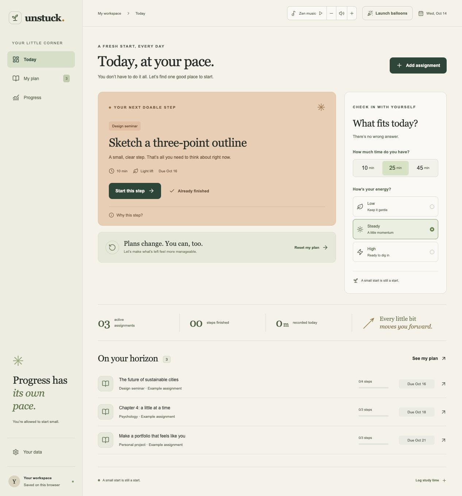

# Unstuck

A student planner for finding one doable next step when a study plan slips.



Unstuck helps students break big assignments into manageable steps, choose what fits their time and energy, and restart when plans change.

[Project story](docs/PROJECT_STORY.md) · [Verification notes](docs/VERIFICATION.md)

The current [hosted preview](https://unstuck-study-swopnab.buzzyclove3.chatgpt.site) is private to its owner. You can run the complete app locally using the steps below.

## Run locally

Requires Node.js 22.12+ (or 20.19+).

```sh
npm ci
npm run dev
```

Open the local URL printed by Vite. For a production build:

```sh
npm run build
npm run preview
```

Run the scheduling, recovery, import, and activity checks with `npm test` on Node.js 22+.

## What works

- Add and edit assignments, deadlines, and up to 20 ordered steps. Each step has an estimate, energy requirement, and optional flag.
- Choose 10, 25, or 45 available minutes and low, steady, or high energy. The suggestion uses the first unfinished step in each assignment, energy fit, then deadline. Long steps become shorter focus chunks.
- Complete and reopen steps; view active, completed, or all assignments.
- Run, pause, resume, and save a focus timer. It uses a timestamp so background tabs do not slow the countdown. Only elapsed whole minutes are recorded. Paused and running timers survive a reload in the same tab.
- Preview recovery by keeping work, halving optional unfinished estimates, or skipping optional steps. Deadlines stay fixed. Capacity estimates apply to the selected assignment; the interface also shows total remaining work.
- View recorded study minutes in the supplied contribution skyline, switch to the heat map, orbit the 3D view, and explore with the keyboard.
- Record past study manually, append CSV history, export JSON/CSV, and restore a versioned backup after confirmation.
- Launch balloons from the welcome and workspace headers. Each click launches an independent batch, even during an existing animation.
- Play the original 48-second ambient soundtrack when entering from the welcome screen, pause/resume it in the header, and adjust volume with up/down buttons (10 percentage points), the slider, or its keyboard controls. Direct links require a playback click if the browser blocks autoplay.

## Data and examples

Records are saved in localStorage on the current browser and origin. They are not uploaded or synced. There is no account, school integration, or GitHub integration. Browser data removal clears the records; JSON export provides a backup.

The initial three assignments are explicitly labeled examples. The skyline receives an explicit `data` array built from saved sessions, including an empty array before anything is recorded. It never uses the supplied component's generated sample year. Manually entered or imported records are user-reported, not independently verified.

The welcome page's workspace preview is a screenshot of the example workspace. It is a static preview, while the Open workspace and Find my next step buttons enter the working app.

## Component integration

This project uses React, TypeScript, Vite, Tailwind v4, and the shadcn structure. Components live in `/components/ui`, shared helpers in `/lib`, and styles in `/src/index.css`. The `@/*` alias points at the project root. Keeping shared UI here makes registry imports consistent and keeps screen-specific state in `src`.

The two user-supplied components are preserved in `components/ui/tilted-grid-hero.tsx` and `components/ui/contribution-skyline.tsx`. Their demo wrappers use local photos and explicit recorded data.

The requested 21st.dev CLI links for container-scroll-animation and balloons returned authentication-required errors. The scroll component was installed from its author's public registry with `npx shadcn@latest add @aceternity/container-scroll-animation --yes`, then moved into the shared UI folder and adapted to the page, with typed props and reduced-motion support. The balloon component is a local React adapter around the same public `balloons-js` library, exposing `launchAnimation`. It does not reproduce the locked 21st wrapper source.

For additional shadcn components, the project is configured already:

```sh
npx shadcn@latest add button
```

Check the generated path after registry installation; some registries write to `src/components/ui`. Move shared components to the project-level folder when necessary.

## Motion and access

The image band offers a pause/play control and respects reduced motion. The scroll reveal uses a static view under reduced motion. The balloons button gives a text celebration under reduced motion. Native dialogs provide focus containment and Escape handling; form fields have labels; the skyline has keyboard navigation and announcements. These features are implemented and selected flows checked, but this is not an accessibility certification or a user study.

## Attribution

- Curved image hero and contribution skyline: user-supplied component source.
- Container scroll: Aceternity UI, https://ui.aceternity.com/components/container-scroll-animation . See THIRD_PARTY_NOTICES.md.
- Balloons: Artur Bień, https://github.com/arturbien/balloons-js . MIT license is included in THIRD_PARTY_NOTICES.md.
- Photos: Unsplash. Verified image URLs and local filenames are listed in ASSETS.json.
- Icons: Lucide.
- Small Steps soundtrack: original synthesized ambient composition generated for this project; no third-party recordings.

## Limits

No automatic calendar scheduling, notifications, AI generation, collaboration, cloud sync, external course data, or actual Devpost submission is implemented. Local storage is scoped to an origin: data created on localhost does not appear automatically on the hosted URL. The capacity estimate is not a promise that an assignment is achievable.

## Review update

See [setup, storage/recovery architecture, demo, calendar export and limitations](docs/RELEASE_REVIEW.md), [prepared usability plan](docs/USABILITY_PLAN.md), and [UI provenance](docs/UI_REUSE.md). The account-free fictional demo is `?demo=1#workspace` and uses separate browser storage.

## Published interface — October 28, 2026

[Open the website](https://swopnab.github.io/Unstuck/?demo=1#workspace). The public fictional demo uses its own browser storage; no account is required. See GitHub Actions for release checks and deployment status.
